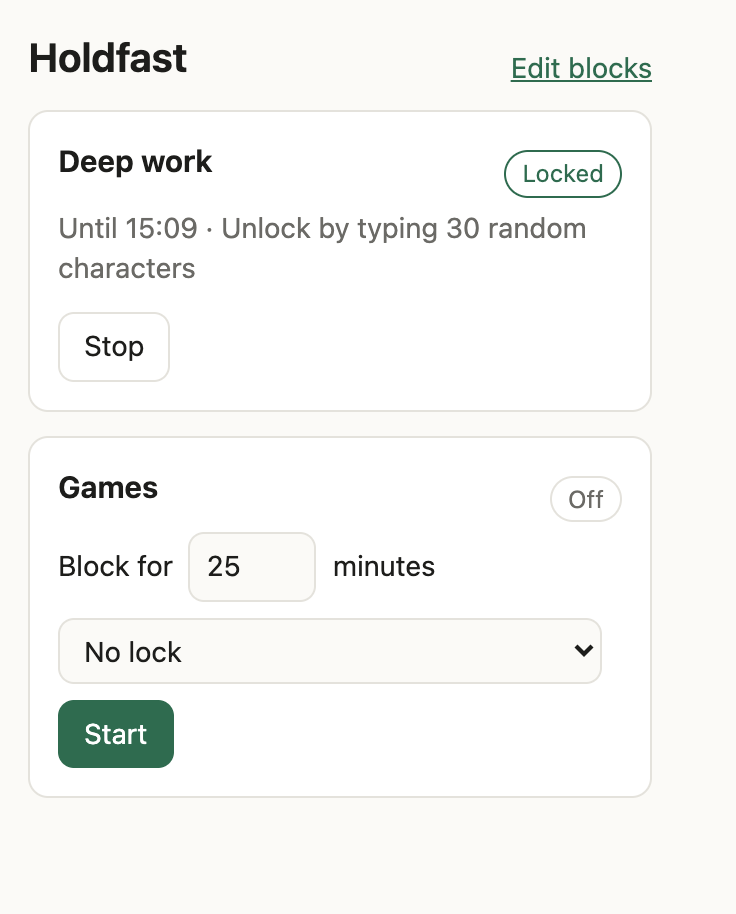
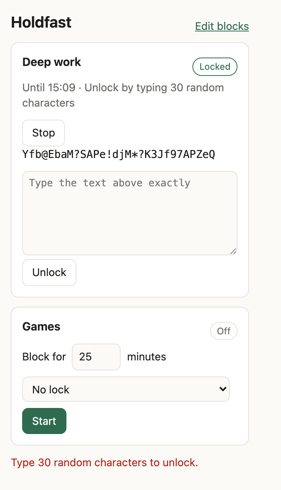
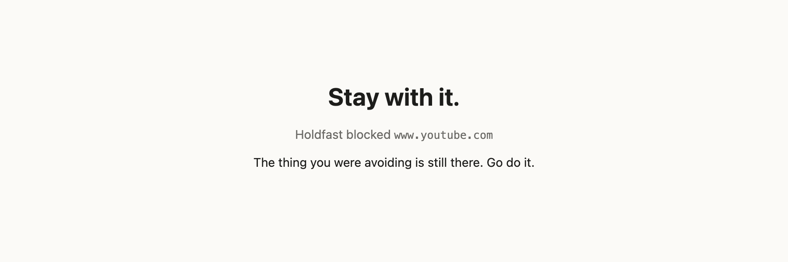
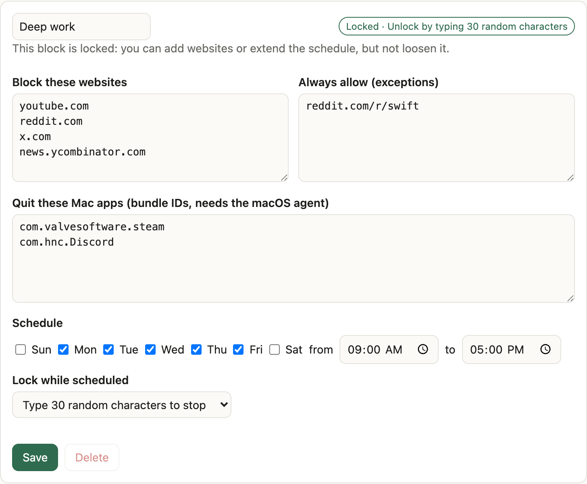
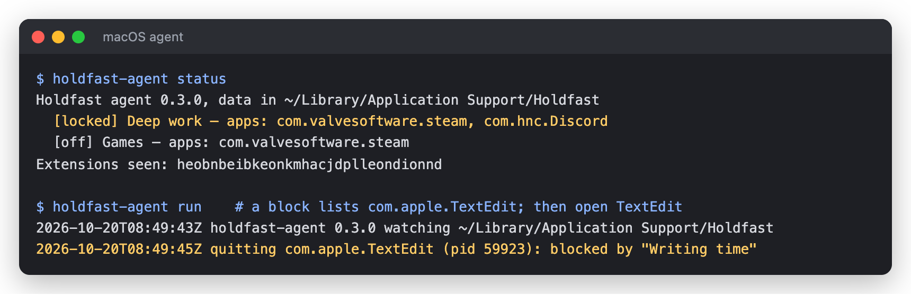
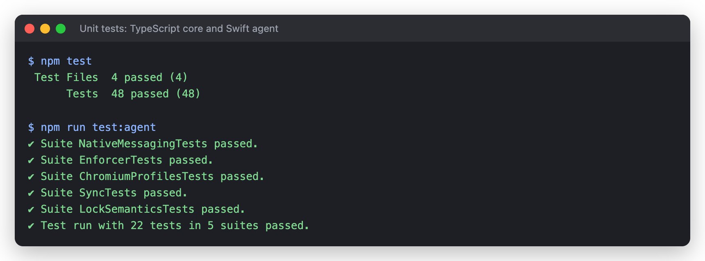
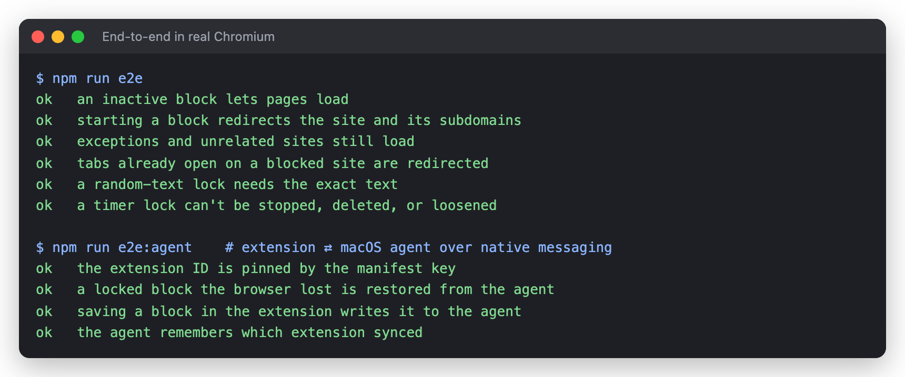
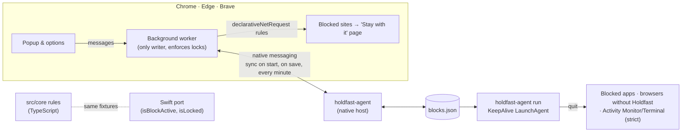

# Holdfast

[](https://github.com/Yashasm18/holdfast/actions/workflows/ci.yml)
[](LICENSE)


**A free, open-source website and app blocker you can't cheat your way out of.**

<p align="center">
  
  &nbsp;&nbsp;
  
</p>
<p align="center"><sub>Left: a block running with a random-text lock. Right: pressing <b>Stop</b> asks you to type 30 random characters by hand. Paste is disabled.</sub></p>

Paid focus apps charge a subscription for something your browser can already do.
Holdfast blocks distracting sites on a schedule or on demand, and its locks
mean "I'll just turn it off for a minute" stops working.

- **Block lists**: domains (and all their subdomains), specific paths,
  `*` wildcards, or plain keywords. Add exceptions for the parts you need.
- **Schedules**: run a block every weekday from 9 to 5, or start one for the
  next 25 minutes.
- **Locks** that make a running block hard to stop:
  - *Random text*: to stop early, type 30 or 120 random characters by hand.
    Paste is disabled.
  - *Timer*: can't be stopped until the time runs out.
  - *Until it ends*: can't be stopped at all while it's active.
- **Locked means locked**: while a block is locked you can add sites or extend
  its schedule, but you can't remove sites, add exceptions, shorten it, weaken
  the lock, or delete it.
- **App blocking on macOS** with the optional agent: quit distracting apps while
  a block runs, and keep the extension from being removed while it's locked.
- **Private by design**: no account, no server, no tracking. Everything stays
  on your machine.

## See it work

Every image below comes from the real extension and agent, or from real test
output, generated by [`npm run screenshots`](scripts/screenshots.mjs). Nothing
is a mockup, and you can regenerate them yourself.

**Going to a blocked site** sends you to this page instead. The browser
redirects the request before it leaves your machine:



**Editing a locked block.** You can add websites, apps or schedule time, but
the extension refuses to remove sites, add exceptions, weaken the lock or
delete the block until the lock ends. The *Quit these Mac apps* list is
enforced by the macOS agent:

<p align="center"></p>

**The macOS agent** receives the blocks from the extension over native
messaging, and quits blocked apps as soon as they open. Below, TextEdit was
quit about a second after it launched:



**Tested.** 48 TypeScript tests and 22 Swift tests. The rules for when a block
is active and locked live in both languages, and both run the same
[shared fixtures](tests/fixtures/lock-semantics.json), so the extension and the
agent can't drift apart. End-to-end tests load the real extension into
Chromium, and one connects it to the real agent binary. [CI](https://github.com/Yashasm18/holdfast/actions/workflows/ci.yml)
runs all of it on every push.




### How the pieces fit



The extension and the agent each restore the other. If the extension is
reinstalled mid-lock, the agent hands back the locked blocks. If the agent's
file is wiped, the extension rewrites it within a minute.

## Install (from source)

```bash
npm install
npm run build
```

Then in Chrome, Edge, Brave, Arc or another Chromium browser: open
`chrome://extensions`, turn on **Developer mode**, click **Load unpacked**, and
pick `dist/extension`. To make it apply in private windows too, open the
extension's details and turn on **Allow in Incognito**.

### macOS agent (optional)

The extension blocks websites. The optional macOS agent also **quits blocked
apps**, restarts itself if it's killed, and, while a block is locked, closes
Chromium browsers that don't have Holdfast installed and refuses to uninstall.
It's a small Swift program that installs per user, no `sudo` needed:

```bash
cd agent/macos
./install.sh             # add --strict to also quit Activity Monitor and Terminal while locked
```

This builds the agent and registers it as a `KeepAlive` LaunchAgent and as a
native messaging host for Chrome, Edge and Brave (plus Chromium, Vivaldi and Arc
if installed). Reload the extension afterwards so it syncs your blocks. Then
list Mac apps to quit in a block's **Quit these Mac apps** box, by bundle ID
(`osascript -e 'id of app "Steam"'` prints one). Remove it with
`./uninstall.sh`, which refuses while a block is locked. Details, settings and
limits: [docs/macos-agent.md](docs/macos-agent.md).

## How it works

Holdfast turns your active blocks into browser
[`declarativeNetRequest`](https://developer.chrome.com/docs/extensions/reference/api/declarativeNetRequest)
rules, so the browser itself redirects blocked pages to a calm "Stay with it"
screen. Nothing inspects your traffic, and blocking keeps working even while the
extension's background worker is asleep. A one-minute alarm keeps scheduled
blocks in sync, and tabs that are already open on a blocked site are redirected
the moment a block starts.

All the rules (pattern matching, schedules, lock checks) live in a small,
browser-free TypeScript core (`src/core`) with unit tests, so a future desktop
agent can share exactly the same logic. See [docs/architecture.md](docs/architecture.md).

## Development

```bash
npm test          # unit tests for the core rules
npm run typecheck
npm run e2e       # loads the built extension into Chromium and checks real blocking
npm run watch     # rebuild on change
npm run test:agent   # Swift tests for the macOS agent
npm run e2e:agent    # extension ⇄ agent sync over native messaging, in a throwaway profile
npm run screenshots  # regenerate the README images from real runs (add -- --app-demo for the TextEdit demo)
```

`npm run e2e` needs a Chromium that allows unpacked extensions: Playwright's
Chromium, or set `CHROME_PATH` to Chrome for Testing. Branded Google Chrome
ignores `--load-extension`.

## Roadmap

See [docs/roadmap.md](docs/roadmap.md).

## Background

Holdfast's feature set was informed by a behavioral study of how a popular paid
blocker works. See [docs/research/cold-turkey-teardown.md](docs/research/cold-turkey-teardown.md).
No code, assets, or text from any other product are used here. Holdfast is an
independent project, not affiliated with Cold Turkey or any other vendor.

## License

[MIT](LICENSE)
